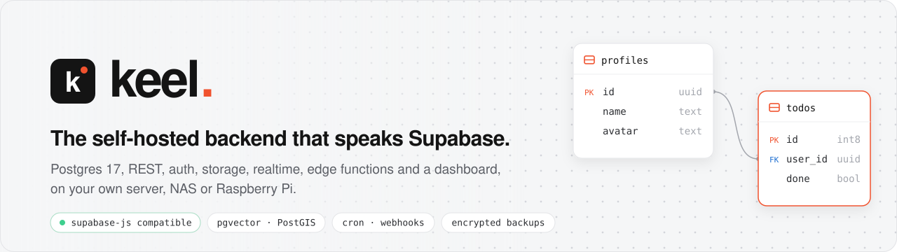
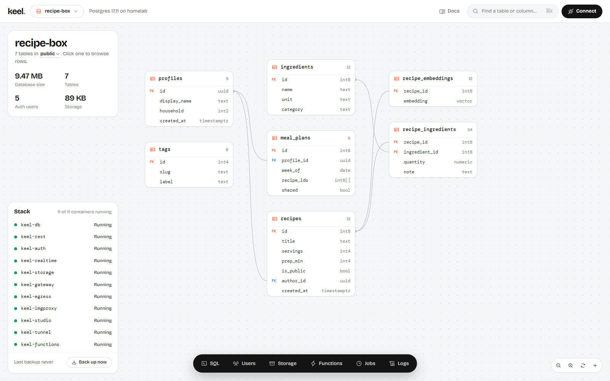
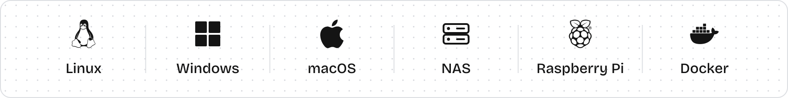
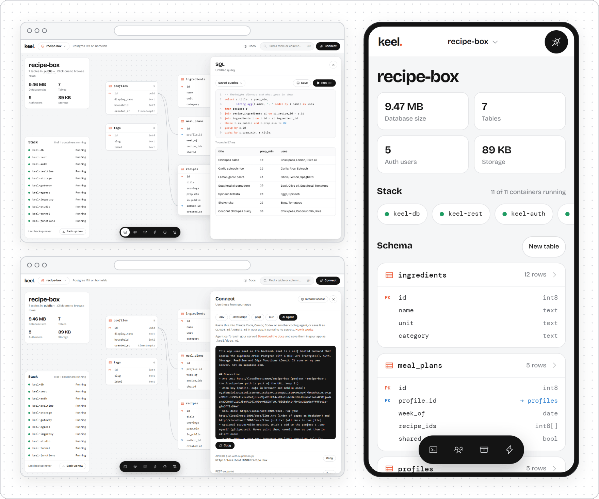

<a id="readme-top"></a>

<div align="center">

<picture>
  <source media="(prefers-color-scheme: dark)" srcset=".github/assets/banner-dark.svg">
  <source media="(prefers-color-scheme: light)" srcset=".github/assets/banner-light.svg">
  
</picture>

<br>

[](https://github.com/niklan1110/keel/actions/workflows/release.yml)
[](https://github.com/niklan1110/keel/releases/latest)
[](LICENSE)
[](website/reference/compatibility.md)
[](#security)

### Postgres with an instant REST API, auth, file storage, realtime, edge functions and a dashboard,<br>on a machine you own, speaking the same APIs as Supabase.

[**Quick start**](#quick-start) ·
[Features](#features) ·
[Keel and Supabase](#keel-and-supabase) ·
[Security](#security) ·
[Docs](#documentation) ·
[Roadmap](#roadmap)

<br>

[](website/self-hosting/docker.md)
[](website/self-hosting/docker.md)
[](website/self-hosting/macos.md)
[](website/self-hosting/windows.md)
[](website/self-hosting/platforms.md#raspberry-pi-and-small-nas)
<br>
[](website/self-hosting/synology.md)
[](website/self-hosting/unraid.md)
[](website/self-hosting/truenas.md)
[](website/self-hosting/zimaos.md)

</div>

<br>

> [!TIP]
> **Supabase API compatible.** Apps keep using the regular [`@supabase/supabase-js`](https://github.com/supabase/supabase-js) client. Point it at your own server instead of the cloud, and most Supabase guides apply as written.

```js
import { createClient } from '@supabase/supabase-js'

const keel = createClient('http://homelab.local:8000/recipe-box', process.env.KEEL_ANON_KEY)

const { data } = await keel.from('recipes').select('title, author:profiles(display_name)')
```

<p align="center">
  
</p>

## Highlights

<table>
<tr>
<td width="33%" valign="top">


**Speaks Supabase**

The same HTTP and WebSocket APIs, the same client, the same row level security patterns. Every change is tested against a running server with `supabase-js` v2.

</td>
<td width="33%" valign="top">


**Your data, your hardware**

One machine: a home server, a NAS, a mini PC or a Raspberry Pi, in 1 to 2 GB of RAM. Apart from a daily check for new releases (which you can turn off), nothing leaves it unless you ask.

</td>
<td width="33%" valign="top">


**Safe by default**

Row level security on every new table, Studio and Postgres closed to the network until you open them, sandboxed functions and outgoing requests, and signed release images.

</td>
</tr>
<tr>
<td valign="top">


**Vectors and maps**

The `keel-postgres` image is Postgres 17 with **pgvector** for embeddings and nearest-neighbour search, and **PostGIS** for geometry, geography and GeoJSON.

</td>
<td valign="top">


**Jobs and webhooks**

`cron.schedule` and `net.http_post` in every project, plus Supabase's database webhooks. Requests go out through `keel-egress`, a sandboxed sender that can't reach your network.

</td>
<td valign="top">


**Backups that leave the house**

Encrypted full backups (age format) of every database, setting and uploaded file, copied to any S3-compatible bucket. `./keel restore` rebuilds a whole install on a new machine.

</td>
</tr>
</table>

<p align="right"><a href="#readme-top">↑ back to top</a></p>

## Quick start

<p align="center">
<picture>
  <source media="(prefers-color-scheme: dark)" srcset=".github/assets/platforms-dark.svg">
  
</picture>
</p>

You need Docker with the Compose plugin (`docker compose version` prints v2 or newer). Each release has its own installer with a SHA-256 checksum. On Linux, macOS or a NAS, download it, check it, then run it:

```bash
curl -fsSLO https://github.com/niklan1110/keel/releases/latest/download/install.sh
curl -fsSLO https://github.com/niklan1110/keel/releases/latest/download/install.sh.sha256
sha256sum -c install.sh.sha256      # macOS: shasum -a 256 -c install.sh.sha256
sudo bash install.sh                # macOS: bash install.sh (without sudo)
```

The installer picks the right folder for your system, checks every file it downloads, writes a `.env` with random passwords, starts Keel and prints your Studio login:

```text
Keel is running.

  Studio (dashboard):  http://192.168.1.20:3000
  Sign in:             admin / <generated password>
  API for your apps:   http://192.168.1.20:8000/my-app
```

A first project called `my-app` is ready. Open Studio, change your password and turn on two-factor authentication under **Account and security**. The [Quickstart](website/guide/quickstart.md) goes from there to your first table and query in about ten minutes.

Pick your platform for the details:

<details>
<summary>&nbsp; <b>Linux server or PC</b></summary>

<br>

Run the installer above with `sudo`. Keel goes into `/opt/keel` (or `~/keel` without `sudo`). It asks whether to open Studio to your network; on a cloud server it keeps Studio on the machine. Options such as `--lan`, `--host nas.local` and `--version 0.2.0` are listed in [Docker Compose](website/self-hosting/docker.md#options). Running the installer again updates Keel, with a database backup first.

</details>

<details>
<summary>&nbsp; <b>Windows 10 and 11</b></summary>

<br>

Start [Docker Desktop](https://www.docker.com/products/docker-desktop/) (it should say *Engine running*), open **PowerShell** (no administrator needed) and run the Windows installer. It needs neither a WSL terminal nor Git Bash:

```powershell
Invoke-WebRequest https://github.com/niklan1110/keel/releases/latest/download/install.ps1 -OutFile install.ps1 -UseBasicParsing
Invoke-WebRequest https://github.com/niklan1110/keel/releases/latest/download/install.ps1.sha256 -OutFile install.ps1.sha256 -UseBasicParsing
if ((Get-FileHash install.ps1).Hash -eq (Get-Content install.ps1.sha256).Split(' ')[0]) {
  powershell -ExecutionPolicy Bypass -File .\install.ps1
} else { 'install.ps1 does not match its checksum: do not run it' }
```

Keel goes into `%USERPROFILE%\keel`, keeps Studio and Postgres on your PC unless you pass `-Lan` / `-LanDb`, stores Postgres' data in a Docker volume (much faster than the Windows drive) and installs a `keel` command (`keel.cmd`) with the same `up`, `update` and `rollback` as on Linux. See [Windows](website/self-hosting/windows.md).

</details>

<details>
<summary>&nbsp; <b>macOS</b></summary>

<br>

Start [Docker Desktop](https://www.docker.com/products/docker-desktop/), [OrbStack](https://orbstack.dev) or Colima, then run the installer in Terminal **without `sudo`** (`bash install.sh`). Keel goes into `~/keel` and keeps Studio on your Mac. Works on Apple Silicon and Intel. See [macOS](website/self-hosting/macos.md).

</details>

<details>
<summary>&nbsp; <b>NAS: Synology, Unraid, TrueNAS SCALE, ZimaOS, CasaOS</b></summary>

<br>

Run the installer over SSH or in the NAS's web terminal. It opens Studio to your network and uses the usual app folder:

| NAS | Install folder | Guide |
|---|---|---|
| Synology DSM 7.2+ | `/volume1/docker/keel` | [Synology](website/self-hosting/synology.md) |
| Unraid 6.12 and 7 | `/mnt/user/appdata/keel` | [Unraid](website/self-hosting/unraid.md) |
| TrueNAS SCALE 24.10+ | `/mnt/<pool>/apps/keel` | [TrueNAS SCALE](website/self-hosting/truenas.md) |
| ZimaOS, CasaOS | `/DATA/AppData/keel` | [ZimaOS](website/self-hosting/zimaos.md) |

No terminal? Every one of them can also run Keel from its own app screen (Container Manager, Compose Manager, *Install via YAML*, the ZimaOS App Store, Portainer or Dockge) with a single file, `nas-docker-compose.yml`. See [NAS app screens](website/self-hosting/platforms.md#nas-app-screens).

</details>

<details>
<summary>&nbsp; <b>Raspberry Pi and small devices</b></summary>

<br>

Use a 64-bit OS on a Raspberry Pi 4 or 5, ideally with an SSD. After installing, add the small-device profile, which caps each container's memory (about 1.3 GB in total) and gives Postgres smaller settings:

```bash
cd /opt/keel        # your install folder
sudo curl -fsSLO https://github.com/niklan1110/keel/releases/latest/download/docker-compose.small.yml
echo 'COMPOSE_FILE=docker-compose.yml:docker-compose.small.yml' | sudo tee -a .env
sudo ./keel up
```

See [Raspberry Pi and small NAS](website/self-hosting/platforms.md#raspberry-pi-and-small-nas).

</details>

<details>
<summary>&nbsp; <b>Docker Compose from source</b></summary>

<br>

Build the images from a clone instead of downloading them. You also need `openssl`.

```bash
git clone https://github.com/niklan1110/keel keel && cd keel
./keel init --url http://<server-ip-or-hostname>:8000    # add --lan to open Studio to your network
./keel up
```

Studio is at `http://localhost:3000`. To set up the published compose file by hand without the installer, see [Install by hand](website/self-hosting/docker.md#install-by-hand).

</details>

<p align="right"><a href="#readme-top">↑ back to top</a></p>

## Features

| | |
|---|---|
| 🐘 **Database & REST** | Postgres 17 with one database per project. [PostgREST](https://postgrest.org) 12 for every project: filters, joins through foreign keys, RPC, upserts, pagination. Connect directly with `psql`, Prisma or Drizzle. [Docs](website/database/overview.md) |
| 🧭 **Vectors & maps** | pgvector 0.8 (`vector` columns, HNSW and IVFFlat indexes, `match_documents`-style search) and PostGIS 3.6 (`geometry`, `geography`, spatial indexes, `.geojson()`), plus the Postgres contrib extensions. [Docs](website/database/extensions.md) |
| 🔐 **Auth** | Email and password, magic links and codes, phone sign-in by SMS (Twilio, Vonage, MessageBird or your own webhook), two-factor (TOTP and SMS), anonymous users, PKCE, invites and the admin API. JWTs work with `auth.uid()` in your policies. [Docs](website/auth/overview.md) |
| 🪪 **Social & SSO sign-in** | GitHub, Google, Discord, GitLab (including your own) and Microsoft, plus any OpenID Connect provider such as Authentik, Keycloak, Authelia, Pocket ID or Zitadel, with `signInWithOAuth({ provider: 'custom:<id>' })` as in Supabase. [Social](website/auth/oauth.md) · [OIDC](website/auth/oidc.md) |
| ⏰ **Jobs & webhooks** | Scheduled jobs with `cron.schedule`, HTTP calls from SQL with `net.http_get` and `net.http_post`, and Supabase's database webhook triggers, built into every project. Requests are sent by `keel-egress`, which refuses private and LAN addresses. Studio's **Jobs** tool shows runs and responses. [Cron](website/database/cron.md) · [Webhooks](website/database/webhooks.md) |
| 🗂️ **Storage** | Public and private buckets, signed URLs and signed uploads, resumable uploads (TUS) and image resizing, with access control through policies on `storage.objects`. [Docs](website/storage/overview.md) |
| ⚡ **Realtime** | Database changes that respect row level security, broadcast and presence over WebSockets, private channels, and broadcasts from SQL and triggers. [Docs](website/realtime/overview.md) |
| 🧩 **Edge Functions** | TypeScript on [Deno](https://deno.com), written like Supabase Edge Functions (`Deno.serve`), with secrets, logs and a test runner. Each function runs sandboxed in its own process. [Docs](website/functions/overview.md) |
| 🖥️ **Studio** | A dashboard for the schema canvas, table editor, SQL editor, policies, users, files, functions, jobs, container logs, API keys and backups. Works on a phone. Has a ready-made prompt for AI coding agents with your project's URL and docs. [Tour](website/studio/tour.md) |
| 💾 **Backups & recovery** | Nightly `pg_dump` of every project with one-click restores. Encrypted full backups (every database, setting and uploaded file, in the age format) copied to any S3-compatible bucket: AWS S3, Backblaze B2, Cloudflare R2, Wasabi, MinIO. `./keel restore` brings a whole install back on a new machine; `./keel update` backs up first and `./keel rollback` goes back. [Docs](website/self-hosting/backups.md) |
| 📦 **Import from Supabase** | Copies a Supabase project's schema, data, users (passwords keep working), policies, pgvector and PostGIS, and files into Keel. Supabase is only read. [Docs](website/self-hosting/migrate-from-supabase.md) |
| 🌐 **Cloudflare Tunnel** | Put the API on your own domain over HTTPS without opening a port: paste a tunnel token in Studio. Caddy, nginx, Traefik and Tailscale work too. [Docs](website/self-hosting/cloudflare-tunnel.md) |

Each project gets its own database, API keys, users, buckets and URL, side by side on one server.

<picture>
  <source media="(prefers-color-scheme: dark)" srcset=".github/assets/showcase-dark.png">
  
</picture>
<p align="center"><sub>Studio: SQL editor, the Connect panel with keys and an agent prompt, and the phone view</sub></p>

<p align="right"><a href="#readme-top">↑ back to top</a></p>

## Use it from your app

Open **Connect** in Studio for ready-to-copy values: the API URL (`http://<server>:8000/<project>`), the anon key for browsers and apps, the service role key for servers, and the Postgres URL.

```js
await keel.auth.signInWithPassword({ email, password })
await keel.auth.signInWithOAuth({ provider: 'custom:authentik' })                  // any OpenID Connect provider

const { data: todos } = await keel.from('todos').select('*').order('created_at')   // RLS applies

const { data: similar } = await keel.rpc('match_documents', { query_embedding, match_count: 5 })   // pgvector

await keel.storage.from('avatars').upload(`${user.id}/me.png`, file)

keel.channel('todos')
  .on('postgres_changes', { event: '*', schema: 'public', table: 'todos' }, (e) => console.log(e))
  .subscribe()
```

And from SQL, in any project:

```sql
-- every night at 03:00 UTC
select cron.schedule('tidy-up', '0 3 * * *', $$ delete from sessions where expires_at < now() $$);

-- call a webhook (or your own edge function) from SQL
select net.http_post(url := 'https://<your-webhook>/new-order', body := '{"id": 42}'::jsonb);
```

<details>
<summary><b>The <code>keel</code> command</b></summary>

<br>

```text
./keel init [--url URL] [--lan] [--lan-db]   Create .env with random secrets (source checkout)
./keel up | down | ps | logs [service]       Start, stop and inspect the stack
./keel psql [project]                        psql into a project's database
./keel functions deploy [name ...]           Deploy edge functions from ./supabase/functions
./keel secrets set NAME=value ...            Secrets for edge functions
./keel keys                                  Roll or stop a project's API keys
./keel import-supabase --db-url URL ...      Copy a Supabase project into Keel
./keel update [--version V] | rollback       Update with a backup first, or go back
./keel restore <file> | --list              Bring a whole install back from a full backup
```

On Windows the same commands are `keel up`, `keel update` and so on. Every command and option: [keel CLI](website/self-hosting/cli.md). All settings live in `.env`; see [Configuration](website/self-hosting/configuration.md) and [`.env.example`](.env.example).

</details>

<p align="right"><a href="#readme-top">↑ back to top</a></p>

## Keel and Supabase

Keel implements the HTTP and WebSocket APIs the Supabase client libraries use, and its end-to-end tests drive a running server with `@supabase/supabase-js` v2 on every change. It is a different trade-off from Supabase's own offerings, not a replacement for all of them:

| | **Keel** | Supabase Cloud | Supabase self-hosted |
|---|:---:|:---:|:---:|
| Runs on | Your machine | Supabase's servers | Your machine |
| Install | One installer per platform (Linux, macOS, Windows, NAS) | Sign up | Docker Compose; you set the keys and config |
| Projects per server | Many, each with its own database, keys and URL | Many | One per stack |
| Dashboard login | Accounts with two-factor | Accounts with two-factor and SSO | One shared username and password |
| REST, auth, storage, realtime, edge functions | ✅ | ✅ | ✅ |
| pgvector, PostGIS, cron, `pg_net`, webhooks | ✅ | ✅ | ✅ |
| Encrypted off-site backups | ✅ Built in, to any S3 bucket | ✅ Managed daily backups | Bring your own |
| Point-in-time recovery, branching, read replicas | ❌ | ✅ (paid plans) | ❌ |
| GraphQL, Vault, connection pooler | ❌ | ✅ | ✅ |
| Storage over the S3 protocol, SAML SSO | ❌ | ✅ (SAML on paid plans) | Partly; see Supabase's docs |
| Automatic scaling, global edge network | ❌ One server | ✅ | ❌ |
| Price | Free (FSL, no resale) | Free tier, then paid plans | Free (Apache 2.0) |

Supabase's columns are a summary; check [Supabase's docs](https://supabase.com/docs) for the details of each plan. Keel's own gaps are listed area by area in **[Supabase compatibility](website/reference/compatibility.md)**.

<details>
<summary><b>Compatibility at a glance</b></summary>

<br>

| Area | Status |
|---|---|
| REST (PostgREST 12), RPC, embedding, RLS helpers | ✅ Supported |
| Auth: email, magic links, OTP, phone, MFA, anonymous, PKCE, admin API | ✅ Supported |
| OAuth sign-in | ✅ GitHub, Google, Discord, GitLab, Microsoft and any OpenID Connect provider |
| Storage: buckets, objects, signed URLs, TUS, image transforms | ✅ Supported |
| Realtime: `postgres_changes`, broadcast, presence, private channels | ✅ Supported |
| Edge Functions: `Deno.serve`, secrets, `verify_jwt`, WebSockets | ✅ Supported |
| Extensions | ✅ pgvector, PostGIS (without raster) and Postgres contrib (`pgcrypto`, `pg_trgm`, `citext` and more) |
| Scheduled jobs (`pg_cron` API), HTTP from SQL (`pg_net` API), database webhooks | ✅ Built in, without `create extension` |
| GraphQL, Vault, S3 protocol, SAML, passkeys, connection pooler, branching | ⬜ Not yet |

The API URL includes the project (`http://<server>:8000/my-app`), so pass the full URL to `createClient`.

</details>

<p align="right"><a href="#readme-top">↑ back to top</a></p>

## Security

Keel is meant to sit on your network and, when you choose, on the internet. Its defaults assume that.

- **Row level security on by default** for new tables, including ones made with SQL or migrations. Nothing is exposed through the API until you add a policy.
- **Closed until you open it.** The API listens on your network; Studio and Postgres listen on the machine itself. Postgres needs TLS from other machines and refuses the `postgres` superuser from them.
- **Per-project secrets.** Each project signs its own JWTs; keys can be rolled, stopped or emergency-rolled from Studio or `./keel keys`. Sign-in provider secrets are stored encrypted.
- **Studio accounts** with two-factor authentication, HttpOnly session cookies, rate-limited sign-ins, protection against DNS rebinding and cross-site calls, and two-factor required for sign-ins from the internet.
- **Sandboxed edge functions**: their own process, no access to other files, subprocesses, Keel's passwords or private network addresses.
- **Sandboxed outgoing requests**: HTTP calls from SQL go through `keel-egress`, which has no superuser password, sits on a network of its own, refuses private, LAN, loopback and metadata addresses (IPv4 and IPv6), pins each connection to the address it checked and doesn't follow redirects.
- **Hardened containers**: no Linux capabilities, read-only filesystems where possible, a health check on every service, and a Docker socket proxy that only allows status, logs and restarts.
- **Quiet logs**: sign-in links, codes, email addresses and phone numbers are kept out of them.
- **Encrypted backups**: full backups are encrypted with your passphrase before they leave the machine.
- **Verifiable releases**: images for `amd64` and `arm64` are signed with cosign (keyless), carry an SBOM and build provenance, and are scanned for critical vulnerabilities before they are published. Each installer has a SHA-256 checksum and a build attestation, and checks every file it downloads. See [Check what you run](website/self-hosting/updating.md#check-what-you-run).

Read the [security guide](website/self-hosting/security.md) before putting Keel online. To report a vulnerability privately, see [SECURITY.md](SECURITY.md).

<p align="right"><a href="#readme-top">↑ back to top</a></p>

## Built with

<p align="center">
<a href="https://www.postgresql.org"></a>
<a href="https://postgrest.org"></a>
<a href="https://nodejs.org"></a>
<a href="https://www.typescriptlang.org"></a>
<a href="https://deno.com"></a>
<br>
<a href="https://react.dev"></a>
<a href="https://vite.dev"></a>
<a href="https://vitepress.dev"></a>
<a href="https://www.docker.com"></a>
<a href="https://www.cloudflare.com/products/tunnel/"></a>
<a href="https://github.com/features/actions"></a>
</p>

<p align="center"><sub>Sign in with</sub><br>
<a href="website/auth/oauth.md"></a>
<a href="website/auth/oauth.md"></a>
<a href="website/auth/oauth.md"></a>
<a href="website/auth/oauth.md"></a>
<a href="website/auth/oauth.md"></a>
<a href="website/auth/oidc.md"></a>
<a href="website/auth/oidc.md"></a>
<a href="website/auth/oidc.md"></a>
<a href="website/auth/oidc.md"></a>
</p>

<p align="right"><a href="#readme-top">↑ back to top</a></p>

## Documentation

The full documentation ships with Keel: open **`http://<server>:8000/docs`** or the **Docs** button in Studio. It includes Markdown versions for coding agents (`/docs/llms.txt`, `/docs/llms-full.txt`). The source is in [`website/`](website):

| Start here | Self-hosting | Reference |
|---|---|---|
| [Introduction](website/guide/introduction.md) | [Platforms](website/self-hosting/platforms.md) | [API overview](website/api/overview.md) |
| [Quickstart](website/guide/quickstart.md) | [Requirements](website/self-hosting/requirements.md) | [Supabase compatibility](website/reference/compatibility.md) |
| [Connecting your app](website/guide/connecting.md) | [Backups and disaster recovery](website/self-hosting/backups.md) | [Extensions](website/database/extensions.md) |
| [Build with AI agents](website/guide/ai-agents.md) | [Updating and rollback](website/self-hosting/updating.md) | [Limits](website/reference/limits.md) |
| [Migrate from Supabase](website/self-hosting/migrate-from-supabase.md) | [Internet access and HTTPS](website/self-hosting/remote-access.md) | [Architecture](website/reference/architecture.md) |

## Roadmap

- [x] REST, auth, storage, realtime and edge functions with the Supabase APIs
- [x] pgvector and PostGIS
- [x] Scheduled jobs, HTTP from SQL and database webhooks
- [x] Sign-in with GitHub, Google, Discord, GitLab, Microsoft and OpenID Connect
- [x] Encrypted off-site backups and disaster recovery
- [x] Installers for Linux, macOS, Windows and NAS
- [ ] Storage over the S3 protocol
- [ ] Passkeys
- [ ] Studio roles for teams
- [ ] Prometheus metrics

See [CHANGELOG.md](CHANGELOG.md) for what each release contains.

## Contributing

Bug reports, docs fixes and code are all welcome. Start with [CONTRIBUTING.md](CONTRIBUTING.md) and the [code of conduct](CODE_OF_CONDUCT.md).

```bash
npm ci --ignore-scripts
npm run typecheck && npm test        # types and unit tests
./keel up && npm run test:e2e        # end-to-end tests against a running stack
npm run dev:studio                   # Studio dev server
npm run dev:docs                     # docs dev server
```

## License

Keel is free to use under the [Functional Source License](https://fsl.software) ([FSL-1.1-ALv2](LICENSE)). You can run it, change it and use it inside your company, for free. You can't sell Keel or offer it to others as a competing product or hosted service; if that's what you have in mind, get in touch first through GitHub. Each release also becomes Apache 2.0 two years after it comes out.

The databases and services Keel ships with (Postgres, PostgREST, PostGIS, pgvector, Deno, imgproxy, cloudflared) keep their own licenses.

<p align="right"><a href="#readme-top">↑ back to top</a></p>

---

<div align="center">

<sub>
<b>Keel</b> · Postgres, the Supabase APIs and a dashboard, on hardware you own.<br>
<a href="LICENSE">FSL-1.1-ALv2</a> ·
<a href="SECURITY.md">Security policy</a> ·
<a href="CHANGELOG.md">Changelog</a> ·
<a href="CONTRIBUTING.md">Contributing</a><br>
Keel is independent software and is not affiliated with Supabase.
</sub>

</div>
