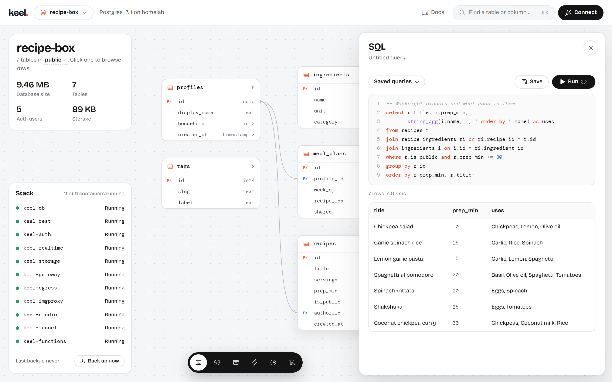
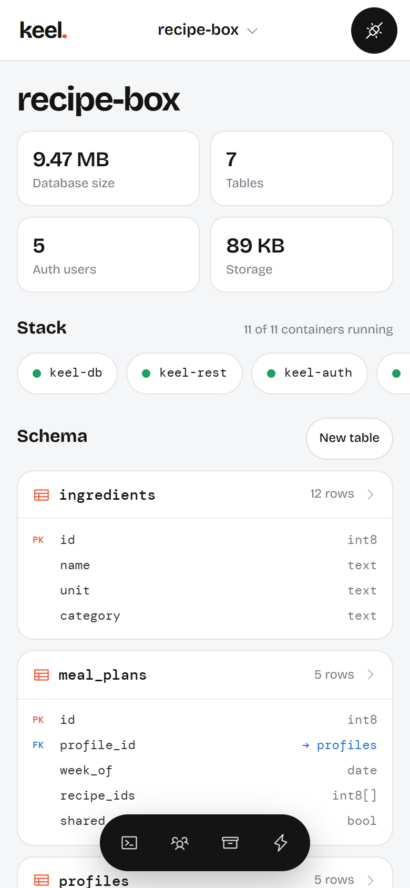

<div class="keel-landing">

<section class="kl-hero" aria-labelledby="kl-hero-title">
  <div class="kl-hero-copy">
    <p class="kl-eyebrow"><span class="kl-dot" aria-hidden="true"></span>Free to self-host · speaks the Supabase APIs</p>
    <h1 id="kl-hero-title">Your backend, on your own server.</h1>
    <p class="kl-lead">Postgres with an instant API, sign-in, file storage, realtime and edge functions, with a dashboard to run it all. On a home server, a NAS or a Raspberry Pi, and your apps keep using <code>supabase-js</code>.</p>
    <div class="kl-actions">
      <a class="kl-btn kl-btn-primary" href="#install">Install Keel</a>
      <a class="kl-btn kl-btn-ghost" href="./guide/introduction">Read the docs</a>
    </div>
    <ul class="kl-facts" aria-label="At a glance">
      <li>1 to 2 GB of RAM</li>
      <li>amd64 and arm64</li>
      <li>Many projects per server</li>
    </ul>
  </div>
  <div class="kl-hero-media">
    <figure class="kl-shot kl-shot-desktop">
      
    </figure>
    <figure class="kl-shot kl-shot-phone">
      
    </figure>
  </div>
</section>

<nav class="kl-platforms" aria-label="Install guides by platform">
  <span class="kl-platforms-label">Installs on</span>
  <ul>
    <li><a href="./self-hosting/docker">Linux</a></li>
    <li><a href="./self-hosting/macos">macOS</a></li>
    <li><a href="./self-hosting/windows">Windows</a></li>
    <li><a href="./self-hosting/platforms">Raspberry Pi</a></li>
    <li><a href="./self-hosting/zimaos">ZimaOS</a></li>
    <li><a href="./self-hosting/unraid">Unraid</a></li>
    <li><a href="./self-hosting/truenas">TrueNAS SCALE</a></li>
    <li><a href="./self-hosting/synology">Synology</a></li>
  </ul>
</nav>

<section class="kl-install" id="install" aria-labelledby="kl-install-title">
  <div class="kl-install-copy">
    <h2 id="kl-install-title">Install in one command</h2>
    <p>The installer checks every file it downloads against published checksums, writes random passwords, starts Keel and prints your sign-in. Run it again to update; the <code>keel</code> command can roll back.</p>
    <p class="kl-small">Want to read it first? <a href="./install.sh" target="_blank" rel="noopener">install.sh</a> · <a href="./install.ps1" target="_blank" rel="noopener">install.ps1</a> · <a href="./self-hosting/requirements">Requirements</a></p>
  </div>
  <div class="kl-install-code vp-doc">

::: code-group

```bash [Linux]
curl -fsSL @@SITE@@/install.sh | sudo bash
```

```bash [macOS]
# Docker Desktop, OrbStack or Colima; run as yourself, without sudo
curl -fsSL @@SITE@@/install.sh | bash
```

```powershell [Windows]
# PowerShell with Docker Desktop: no WSL, no admin rights
irm @@SITE@@/install.ps1 | iex
```

```text [NAS]
1. Open your NAS's compose screen: ZimaOS App Store (custom app),
   Unraid Compose Manager, TrueNAS "Install via YAML",
   or Synology Container Manager
2. Paste @@SITE@@/nas-docker-compose.yml
3. Fill in the CHANGE_ME values and KEEL_PUBLIC_URL, then start it
```

```bash [Compose]
mkdir keel && cd keel
curl -fsSLO @@SITE@@/docker-compose.yml
curl -fsSL @@SITE@@/keel.env.example -o .env
# Fill in the passwords and KEEL_PUBLIC_URL in .env, then:
docker compose up -d
```

:::

  </div>
</section>

<section class="kl-code" aria-labelledby="kl-code-title">
  <div class="kl-code-copy">
    <p class="kl-kicker">Supabase-compatible</p>
    <h2 id="kl-code-title">Keep the Supabase client you know</h2>
    <p>Keel speaks the same HTTP and WebSocket APIs, so moving an app is a new URL and key. Queries, sign-in, uploads and subscriptions work as they do on Supabase, and every change to Keel is tested against a running server with <code>supabase-js</code> v2.</p>
    <a class="kl-link" href="./guide/connecting">Connecting your app</a>
  </div>
  <div class="kl-code-block vp-doc">

```js
import { createClient } from '@supabase/supabase-js'

const keel = createClient('https://abcd.supabase.co', ANON_KEY) // [!code --]
const keel = createClient('http://192.168.1.20:8000/my-app', ANON_KEY) // [!code ++]

await keel.auth.signInWithOAuth({ provider: 'github' })

const { data } = await keel
  .from('recipes')
  .select('title, author:profiles(display_name)')

keel.channel('kitchen')
  .on('postgres_changes', { event: '*', schema: 'public', table: 'recipes' }, show)
  .subscribe()
```

  </div>
</section>

<section class="kl-features" aria-labelledby="kl-features-title">
  <div class="kl-section-head">
    <p class="kl-kicker">What's included</p>
    <h2 id="kl-features-title">Everything an app needs behind it</h2>
    <p>One install runs many projects. Each gets its own database, keys, users and files.</p>
  </div>
  <div class="kl-bento">
    <a class="kl-tile kl-tile-wide kl-tile-db" href="./database/overview">
      <KIcon name="database" />
      <strong>Postgres 17 with an instant API</strong>
      <span>A REST API generated from your tables, with row level security deciding who sees what. <b>pgvector</b> for embeddings and nearest-neighbour search, <b>PostGIS</b> for maps and GeoJSON.</span>
    </a>
    <a class="kl-tile kl-tile-ink" href="./auth/overview">
      <KIcon name="key" />
      <strong>Auth</strong>
      <span>Email and password, magic links, SMS codes, two-factor and anonymous users. GitHub, Google, Discord, GitLab, Microsoft, and any OpenID Connect server: Authentik, Keycloak, Authelia, Pocket ID, Zitadel.</span>
    </a>
    <a class="kl-tile" href="./storage/overview">
      <KIcon name="archive" />
      <strong>Storage</strong>
      <span>Buckets with policies, signed URLs, resumable uploads and on-the-fly image resizing.</span>
    </a>
    <a class="kl-tile" href="./realtime/overview">
      <KIcon name="radio" />
      <strong>Realtime</strong>
      <span>Database changes, broadcast and presence over WebSockets, with private channels.</span>
    </a>
    <a class="kl-tile kl-tile-accent" href="./functions/overview">
      <KIcon name="zap" />
      <strong>Edge functions</strong>
      <span>TypeScript on Deno for webhooks, payments and anything that needs a secret, each in its own sandboxed process.</span>
    </a>
    <a class="kl-tile" href="./database/cron">
      <KIcon name="clock" />
      <strong>Scheduled jobs and webhooks</strong>
      <span><code>cron.schedule</code>, <code>net.http_post</code> and Supabase's database webhooks in every project. Requests go out through a sandboxed sender.</span>
    </a>
    <a class="kl-tile kl-tile-wide" href="./self-hosting/backups">
      <KIcon name="restore" />
      <strong>Backups that leave the house</strong>
      <span>Encrypted full backups of every database, setting and uploaded file, copied each night to any S3-compatible bucket: Backblaze B2, Cloudflare R2, Wasabi, MinIO or AWS. <code>./keel restore</code> rebuilds the whole install on a new machine.</span>
    </a>
    <a class="kl-tile kl-tile-shot" href="./studio/tour">
      <span class="kl-tile-text">
        <KIcon name="layout" />
        <strong>Studio</strong>
        <span>Tables, SQL, users, files, functions, jobs, logs and backups in one dashboard, with two-factor sign-in. It works on a phone too, and can hand a ready-made prompt to AI coding agents.</span>
        <span class="kl-link" aria-hidden="true">Take the tour</span>
      </span>
      
    </a>
  </div>
</section>

<section class="kl-security" aria-labelledby="kl-security-title">
  <div class="kl-security-head">
    <p class="kl-kicker">Security</p>
    <h2 id="kl-security-title">Safe defaults, for a server that lives on your network</h2>
    <p>Every feature that touches sign-in, secrets, SQL or the network gets a security review before it ships. And Keel sends nothing home: no analytics and no telemetry, only an optional daily check for new releases.</p>
    <a class="kl-link" href="./self-hosting/security">Read the security guide</a>
  </div>
  <ul class="kl-security-list">
    <li><KIcon name="lock" /><div><strong>Closed until you open it</strong><span>Studio and Postgres listen on the machine only; the API on your network. Row level security is on for every new table.</span></div></li>
    <li><KIcon name="key" /><div><strong>Secrets per project</strong><span>Each project signs its own tokens. Roll keys from Studio; sign-in provider secrets are stored encrypted.</span></div></li>
    <li><KIcon name="box" /><div><strong>Sandboxed code and requests</strong><span>Edge functions and HTTP calls from SQL can't reach your LAN, Keel's containers or cloud metadata addresses.</span></div></li>
    <li><KIcon name="shield" /><div><strong>Hardened containers</strong><span>No Linux capabilities, read-only filesystems where possible, and a Docker socket proxy that only allows status, logs and restarts.</span></div></li>
    <li><KIcon name="eyeoff" /><div><strong>Quiet logs</strong><span>Sign-in links, codes, email addresses and phone numbers stay out of them.</span></div></li>
    <li><KIcon name="check" /><div><strong>Releases you can verify</strong><span>Signed images with an SBOM and build provenance, scanned before they're published. Installers check every file they download.</span></div></li>
  </ul>
</section>

<section class="kl-pair" aria-label="Going online and moving from Supabase">
  <a class="kl-pair-card" href="./self-hosting/cloudflare-tunnel">
    <KIcon name="globe" :size="22" />
    <h2>Online without opening your router</h2>
    <p>Paste a Cloudflare Tunnel token into Studio and your API is online at your own domain. The tunnel reaches Keel and nothing else on the machine; Studio stays private.</p>
    <span class="kl-link" aria-hidden="true">Set up a tunnel</span>
  </a>
  <a class="kl-pair-card" href="./self-hosting/migrate-from-supabase">
    <KIcon name="move" :size="22" />
    <h2>Moving from Supabase?</h2>
    <p>The importer copies tables, data, users (their passwords keep working), policies, pgvector and PostGIS data, and files into a Keel project. Supabase is only read.</p>
    <span class="kl-link" aria-hidden="true">How importing works</span>
  </a>
</section>

<section class="kl-compare" aria-labelledby="kl-compare-title">
  <div class="kl-section-head">
    <p class="kl-kicker">An honest comparison</p>
    <h2 id="kl-compare-title">Keel and Supabase</h2>
    <p>A different trade-off, not a replacement for everything Supabase does. Supabase's columns are a summary; check <a href="https://supabase.com/docs" target="_blank" rel="noopener">Supabase's docs</a> for each plan, and Keel's gaps area by area in <a href="./reference/compatibility">Supabase compatibility</a>.</p>
  </div>
  <div class="kl-table-wrap" role="region" aria-label="Comparison of Keel, Supabase Cloud and self-hosted Supabase" tabindex="0">
    <table class="kl-table">
      <thead>
        <tr><th scope="col"><span class="kl-sr">Feature</span></th><th scope="col" class="kl-col-keel">Keel</th><th scope="col">Supabase Cloud</th><th scope="col">Supabase self-hosted</th></tr>
      </thead>
      <tbody>
        <tr><th scope="row">Runs on</th><td data-label="Keel" class="kl-col-keel"><span class="kl-v">Your machine</span></td><td data-label="Supabase Cloud"><span class="kl-v">Supabase's servers</span></td><td data-label="Supabase self-hosted"><span class="kl-v">Your machine</span></td></tr>
        <tr><th scope="row">Install</th><td data-label="Keel" class="kl-col-keel"><span class="kl-v">One installer per platform: Linux, macOS, Windows, NAS</span></td><td data-label="Supabase Cloud"><span class="kl-v">Sign up</span></td><td data-label="Supabase self-hosted"><span class="kl-v">Docker Compose; you set the keys and config</span></td></tr>
        <tr><th scope="row">Projects per server</th><td data-label="Keel" class="kl-col-keel"><span class="kl-v">Many, each with its own database, keys and URL</span></td><td data-label="Supabase Cloud"><span class="kl-v">Many</span></td><td data-label="Supabase self-hosted"><span class="kl-v">One per stack</span></td></tr>
        <tr><th scope="row">Dashboard login</th><td data-label="Keel" class="kl-col-keel"><span class="kl-v">Accounts with two-factor</span></td><td data-label="Supabase Cloud"><span class="kl-v">Accounts with two-factor and SSO</span></td><td data-label="Supabase self-hosted"><span class="kl-v">One shared username and password</span></td></tr>
        <tr><th scope="row">REST, auth, storage, realtime, edge functions</th><td data-label="Keel" class="kl-col-keel"><span class="kl-v"><span class="kl-yes">Yes</span></span></td><td data-label="Supabase Cloud"><span class="kl-v"><span class="kl-yes">Yes</span></span></td><td data-label="Supabase self-hosted"><span class="kl-v"><span class="kl-yes">Yes</span></span></td></tr>
        <tr><th scope="row">pgvector, PostGIS, cron, <code>pg_net</code>, webhooks</th><td data-label="Keel" class="kl-col-keel"><span class="kl-v"><span class="kl-yes">Yes</span></span></td><td data-label="Supabase Cloud"><span class="kl-v"><span class="kl-yes">Yes</span></span></td><td data-label="Supabase self-hosted"><span class="kl-v"><span class="kl-yes">Yes</span></span></td></tr>
        <tr><th scope="row">Encrypted off-site backups</th><td data-label="Keel" class="kl-col-keel"><span class="kl-v"><span class="kl-yes">Built in</span>, to any S3 bucket</span></td><td data-label="Supabase Cloud"><span class="kl-v"><span class="kl-yes">Managed</span> daily backups</span></td><td data-label="Supabase self-hosted"><span class="kl-v">Bring your own</span></td></tr>
        <tr><th scope="row">Point-in-time recovery, branching, read replicas</th><td data-label="Keel" class="kl-col-keel"><span class="kl-v"><span class="kl-no">No</span></span></td><td data-label="Supabase Cloud"><span class="kl-v"><span class="kl-yes">Yes</span> (paid plans)</span></td><td data-label="Supabase self-hosted"><span class="kl-v"><span class="kl-no">No</span></span></td></tr>
        <tr><th scope="row">GraphQL, Vault, connection pooler</th><td data-label="Keel" class="kl-col-keel"><span class="kl-v"><span class="kl-no">No</span></span></td><td data-label="Supabase Cloud"><span class="kl-v"><span class="kl-yes">Yes</span></span></td><td data-label="Supabase self-hosted"><span class="kl-v"><span class="kl-yes">Yes</span></span></td></tr>
        <tr><th scope="row">Storage over the S3 protocol, SAML SSO</th><td data-label="Keel" class="kl-col-keel"><span class="kl-v"><span class="kl-no">No</span></span></td><td data-label="Supabase Cloud"><span class="kl-v"><span class="kl-yes">Yes</span> (SAML on paid plans)</span></td><td data-label="Supabase self-hosted"><span class="kl-v">Partly; see Supabase's docs</span></td></tr>
        <tr><th scope="row">Automatic scaling, global edge network</th><td data-label="Keel" class="kl-col-keel"><span class="kl-v"><span class="kl-no">No</span>, one server</span></td><td data-label="Supabase Cloud"><span class="kl-v"><span class="kl-yes">Yes</span></span></td><td data-label="Supabase self-hosted"><span class="kl-v"><span class="kl-no">No</span></span></td></tr>
        <tr><th scope="row">Price</th><td data-label="Keel" class="kl-col-keel"><span class="kl-v">Free (FSL, no resale)</span></td><td data-label="Supabase Cloud"><span class="kl-v">Free tier, then paid plans</span></td><td data-label="Supabase self-hosted"><span class="kl-v">Free (Apache 2.0)</span></td></tr>
      </tbody>
    </table>
  </div>
</section>

<section class="kl-faq" aria-labelledby="kl-faq-title">
  <div class="kl-section-head">
    <p class="kl-kicker">Questions</p>
    <h2 id="kl-faq-title">Frequently asked</h2>
  </div>
  <div class="kl-faq-list">
    <details>
      <summary>Is Keel made by Supabase, or does it use Supabase's servers?</summary>
      <p>No. Keel is independent software that implements the same APIs. It never contacts Supabase unless you use the importer to move a project over, and then it only reads.</p>
    </details>
    <details>
      <summary>What hardware do I need?</summary>
      <p>A 64-bit machine with Docker and 1 to 2 GB of free memory: a mini PC, a NAS, a Raspberry Pi 4 or 5, or a spare PC. A machine that stays on is best for apps other devices rely on. See <a href="./self-hosting/requirements">Requirements</a>.</p>
    </details>
    <details>
      <summary>Does it need an internet connection?</summary>
      <p>Only to download Keel and its updates. After that it runs on your network, documentation included. To reach it from outside, use a <a href="./self-hosting/cloudflare-tunnel">Cloudflare Tunnel</a> or your own reverse proxy with HTTPS.</p>
    </details>
    <details>
      <summary>Does Keel collect data about me or my users?</summary>
      <p>No. There's no analytics or telemetry. Studio checks once a day, while you use it, whether a newer release exists; the request carries no cookie, version or ID, and <code>KEEL_UPDATE_CHECK=off</code> turns it off.</p>
    </details>
    <details>
      <summary>Will my existing Supabase app work?</summary>
      <p>Most apps only need a new URL and key. The API URL includes the project (<code>http://&lt;server&gt;:8000/my-app</code>), so pass the full URL to <code>createClient</code>. The <a href="./reference/compatibility">compatibility page</a> lists what works, what differs and what isn't there yet.</p>
    </details>
    <details>
      <summary>Can I run it for a small company?</summary>
      <p>Yes, for internal tools and apps that fit on one server. Put it behind HTTPS, turn on full backups to an off-site bucket, and read the <a href="./self-hosting/security">security guide</a> first. Keel doesn't scale across servers and Studio has a single admin today.</p>
    </details>
    <details>
      <summary>How do updates and backups work?</summary>
      <p>Run the installer again or <code>./keel update</code>; the database is backed up first and <code>./keel rollback</code> goes back. Nightly backups are on by default, and with a passphrase set Keel also writes encrypted full backups you can copy to S3. See <a href="./self-hosting/updating">Updating</a> and <a href="./self-hosting/backups">Backups</a>.</p>
    </details>
  </div>
</section>

<section class="kl-final" aria-labelledby="kl-final-title">
  <h2 id="kl-final-title">Run it on the machine you already have.</h2>
  <p>Install in a few minutes, create a project in Studio, and point your app at it.</p>
  <div class="kl-actions">
    <a class="kl-btn kl-btn-accent" href="#install">Install Keel</a>
    <a class="kl-btn kl-btn-on-ink" href="./guide/quickstart">Follow the quickstart</a>
  </div>
  <p class="kl-small kl-disclaimer">Keel is independent software and is not affiliated with Supabase.</p>
</section>

</div>
